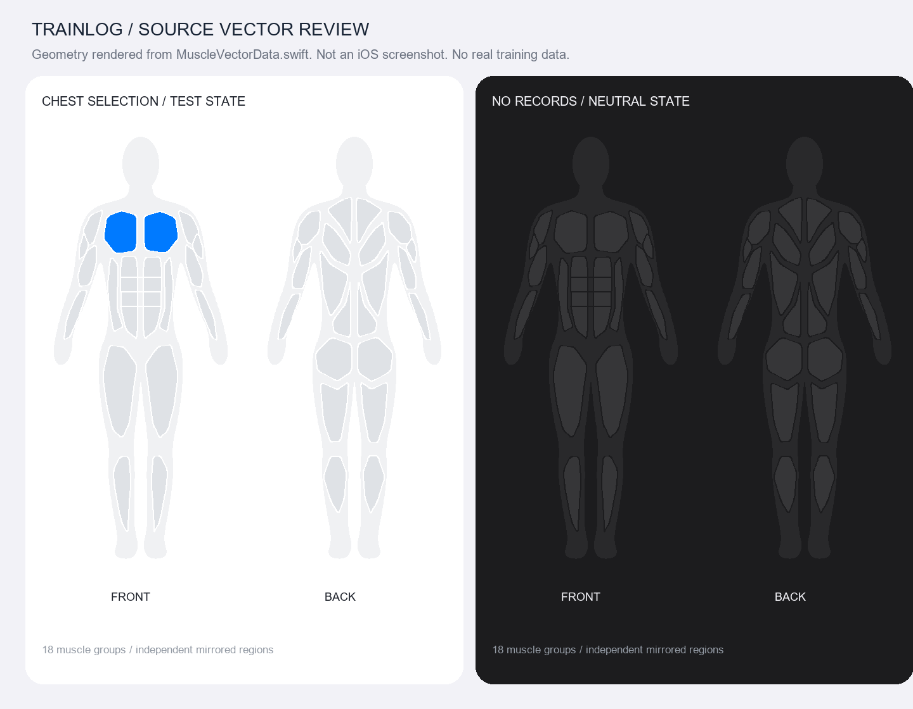

# TrainLog

记录每一次训练，看见每一点进步。

面向力量、有氧与日常运动的本地优先 iPhone / Apple Watch 应用。使用 **SwiftUI、SwiftData、Swift Charts、SF Symbols、HealthKit、WatchConnectivity**；最低 **iOS 27.0 / watchOS 27.0**。无服务器、无账号、无第三方运行时依赖。

## 0.7.0 原生体验与已批准功能

优化草稿保存与失败重试、已完成历史刷新、实时活动判重和原生短动效；新增已批准的手机逐组训练/Watch 数据明确关联，以及交互小组件和快捷指令。B 每周安排、C 云同步未获批准，不开发。详见 [优化说明](Documentation/NATIVE_POLISH.md)、[已批准功能与使用边界](Documentation/APPROVED_FEATURES.md)。

**[v0.7.0 预览版已发布](https://github.com/Xiao8-24/TrainLog/releases/tag/v0.7.0)**；[Actions #33](https://github.com/Xiao8-24/TrainLog/actions/runs/39193170639) 通过 **111 项测试**并完成含 Widget、Watch 的设备归档。五个发布文件已下载校验，源码包127个文件与测试提交一致。IPA 未签名，真实传感器、跨设备连接、Siri、系统小组件及帧率仍需配对真机验收。截图与完整结果见 [验证记录](Documentation/VALIDATION.md)。

## 0.6.1 有氧与 Apple Watch

128 个力量/核心动作与 38 种有氧及其他运动类型，支持时长、适用距离、平均配速/速度、独立运动趋势与任意日期日历；不会混入力量组数与容量。原生 Watch App 支持主动开始、暂停和保存，采集系统可用的心率、活动能量和距离，离线保留直到手机确认接收，避免重复导入与健康重复写入。

单次训练显示心率采样图与系统能量估算；可单独授权读取健康已有的血氧和 VO₂ max，注明日期与来源。血氧不连续采集，不从单次心率推算有氧适能；缺失数据不补零。0.6.1 的 Watch 入口创建独立记录；0.7.0 可先明确连接手机力量草稿，将采集结果附加到同一场训练。详情、签名步骤、备份隐私及真机验收范围见 [有氧与 Apple Watch](Documentation/CARDIO_AND_WATCH.md)。

**[v0.6.1 预览版已发布](https://github.com/Xiao8-24/TrainLog/releases/tag/v0.6.1)**；[Actions #24](https://github.com/Xiao8-24/TrainLog/actions/runs/39094961972) 通过 83 项自动测试并完成含 Widget 与 Watch 的设备归档。0.6.1 将手表上裁切的选择控件改为原生导航列表。五个发布资产已校验，源码包 112 个文件与测试提交一致；真机传感器、健康展示和交互性能仍待配对设备验证。截图复核范围与运行时限制见 [验证记录](Documentation/VALIDATION.md)。IPA 未签名，需分别配置主 App、Widget、Watch 的有效签名后安装。

## 0.5.1 Apple 健康与原生体验

新增可选 HealthKit 连接：授权后自动写入新完成力量训练的类型、起止时间与时长，供 Apple 健康与健身 App 展示；支持单条历史写入、同步状态、失败重试、编辑更新与已管理副本删除。不读取其他来源，不推算心率、热量或圆环进度，不需要 Apple 登录。健康授权和队列不会随 JSON 备份迁移。签名主 App 需启用 HealthKit。详见 [接入、时间规则与设备验收](Documentation/APPLE_HEALTH.md)。

字体统一使用系统默认设计与语义字号，主要标题采用 semibold；计时交给系统文本刷新，休息计时仅更新独立数字，长训练列表按需创建，输入时不再反复排序历史。数字转场和离散交互使用系统动画，支持减少动态效果。云端 iOS 27 已通过 67 项测试与 Release 归档，并复核原生健康设置、浅深色及大辅助字号休息控件截图；真机健康/健身展示与性能仍待验收。

> **[0.5.1 健康连接与原生体验预览版已发布](https://github.com/Xiao8-24/TrainLog/releases/tag/v0.5.1)。** [最终验证](https://github.com/Xiao8-24/TrainLog/actions/runs/39036674709) 在 iOS 27 通过 67 项测试，Xcode 27 Release 归档包含小组件扩展。五个发布文件校验通过，94 个源码文件与测试提交一致。IPA 仍需分别签名主 App 和扩展、配置 App Group，并为主 App 启用 HealthKit。详见[验证记录](Documentation/VALIDATION.md)。

## 0.4.0 桌面小组件与灵动岛

桌面小／中号与锁屏矩形小组件显示今日统计、本周目标和七天训练标记，支持继续草稿和打开日历。详细训练 Live Activities 与灵动岛展示训练计时、暂停、组间倒计时和休息结束状态。链接入口与四个页面共用日历路由，数据库保留原位置。查看[设计、系统行为与签名配置](Documentation/WIDGETS_AND_LIVE_ACTIVITIES.md)。小组件与实时活动的设备展示仍待签名 iPhone 验收。

## 0.3.0 Liquid Glass

系统导航、标签栏、工具栏和日历跟随新系统；主要按钮采用原生玻璃样式，休息计时浮层支持系统滚动边缘效果、大字体和减少透明度回退。数据卡片保持清晰。详见 [适配说明与官方依据](Documentation/LIQUID_GLASS.md)。

## 0.2.0 原生日历与交互

四个主页面右上角均可打开原生健身日历，支持月份/年份切换、日期跳转、返回今天和选中日期恢复。日历查看不受趋势统计范围限制，跨午夜或时区变更后刷新；新增系统动画、触感、减少动态效果支持及历史编辑取消确认。详见 [原生体验改进](Documentation/NATIVE_EXPERIENCE.md)。

## 在 Windows 上体验交互

已提供免安装、可离线运行的 [Windows 交互预览](WindowsPreview/README.md)。在仓库中双击 `WindowsPreview/打开 TrainLog.cmd`，或用 Edge / Chrome 打开同目录的 `index.html`。

预览包含详细／快速训练记录、37 个动作、40 个人体矢量区域、训练暂停与组间休息、草稿恢复、任意日期日历、趋势及小组件／灵动岛状态展示。首次带有可清空的演示记录，修改保存在当前浏览器，与 iPhone 数据相互独立。玻璃效果和动画为浏览器近似呈现，系统组件仍需在 iPhone 验证。

运行 `python Tools/package_windows_preview.py` 可在 `Delivery` 生成独立 HTML、Windows ZIP 和 SHA256 校验文件。独立 HTML 可以单独移动并双击打开，无需启动本地服务。

## 没有 Mac：使用 GitHub 云端构建

已配置 macOS GitHub Actions：运行业务、持久化和 UI 测试，通过后生成源码 ZIP、未签名 iPhone IPA、校验值，并保留测试日志。手动选择 `publish` 可在全部检查成功后创建 GitHub 预览版 Release。

详见 [云端构建与发布步骤](Documentation/GITHUB_RELEASE.md)。仓库：[Xiao8-24/TrainLog](https://github.com/Xiao8-24/TrainLog)。最新构建状态请查看 [Actions](https://github.com/Xiao8-24/TrainLog/actions)，可下载版本请查看 [Releases](https://github.com/Xiao8-24/TrainLog/releases)。未签名 IPA 需要另外完成有效 Apple 签名才能安装；本项目尚未发布到 TestFlight 或 App Store。

## 在 Mac 上打开、编译与安装

1. 将整个仓库或 `Delivery/TrainLog-iOS-source.zip` 解压到 Mac，保留 `Packages/TrainLogCore` 与 `TrainLog.xcodeproj` 的相对位置。
2. 使用 Xcode 27.0 或更新正式版 打开 **`TrainLog.xcodeproj`**。工程不需要 CocoaPods、网络 Swift Package 或额外工程生成器。
3. 选择共享 Scheme **TrainLog** 和已安装的 iPhone 模拟器。按 **⌘B** 构建、**⌘R** 运行。
4. 真机安装：为 TrainLog、TrainLogWidgets、TrainLogWatch 分别配置开发团队与有效签名。主 App 与 Watch 启用 HealthKit，主 App 与 Widget 使用相同 App Group；修改主 App Bundle ID 时同步修改 Watch 的 WKCompanionAppBundleIdentifier。详见[手表签名与验收](Documentation/CARDIO_AND_WATCH.md)。连接并信任配对 iPhone / Watch，在设备启用开发者模式后运行。
5. 使用个人开发团队安装时，签名能力与有效期以 Xcode 当前提示为准。本仓库不包含签名证书、Team ID 或预签名 IPA。

**首次在 Mac 上请先构建和运行测试，再导入重要训练档案。** 不建议通过删除已有数据库来解决构建或迁移问题。

### 测试命令

```bash
# 仅纯 Swift 业务模块，可在有 Swift 的 Mac 上运行
swift test --package-path Packages/TrainLogCore

# 业务模块、SwiftData 集成、原生 UI 测试
bash Tools/test-ios.sh

# 或指定自己的模拟器
TRAINLOG_SIMULATOR_ID="你的模拟器 UUID" bash Tools/test-ios.sh
```

也可以在 Xcode 中按 **⌘U** 运行 `TrainLogTests` 与 `TrainLogUITests`。纯业务包测试由上面的 `swift test` 单独执行。可用 `xcrun simctl list devices available` 查看模拟器标识。

`.github/workflows/ios.yml` 定义完整测试、归档和可选预览版发布流程。当前真实执行状态见上方交付说明及 `Documentation/VALIDATION.md`。

## 已实现的功能源码

| 模块 | 内容 |
|---|---|
| 原生基础 | 四个 Tab、NavigationStack、系统动态字体、深浅主题、首次引导、统一卡片组件 |
| 概览 | 今天状态、本周目标、时长与组数、本月次数、近 30 天训练天数、最近 7 天、近期 PR |
| 人体图 | 18 个肌群、40 个独立前后/左右矢量区域、保持比例缩放、逐区点击、文字替代操作、VoiceOver、Reduce Motion |
| 快速记录 | 肌群图与标签双向选择、日期、时长、轻/中/高、会话 RPE、备注 |
| 详细记录 | 重量/次数/时长、RPE/RIR、正式/热身/递减/失败组、完成标记、复制组、加减重量/次数、组备注 |
| 草稿 | 本地恢复、500 ms 防抖保存、退到后台和关闭前保存、继续/放弃、保存错误提示 |
| 计时 | 训练计时与暂停、手动时长、组间倒计时、恢复截止时间、可选系统通知 |
| 小组件 | 桌面小／中号、锁屏矩形、今日统计、本周目标与七天标记、草稿和日历入口 |
| 实时活动 | 锁屏与灵动岛紧凑／最小／展开、训练计时、暂停、休息倒计时、结束状态、设置开关 |
| Apple 健康 | 可选体能训练写入授权、完成摘要、单条历史写入、确认状态、持久化重试、编辑更新与管理副本删除 |
| 动作库 | 128 个内置动作、主次肌群映射、搜索/肌群/器械筛选、收藏、自定义与历史定义快照 |
| 有氧与运动 | 38 种类型、计时/补录、适用距离与配速/速度、运动趋势、日历和历史 |
| Apple Watch | 原生训练、心率/活动能量/适用距离、离线保存与防重传送、手机分析 |
| 身体数据参考 | 单独授权读取健康已有血氧与 VO₂ max，注明日期来源，不虚构连续血氧或有氧评分 |
| 模板 | Push/Pull/Legs、自定义、动作排序、组数、默认重量次数、复用上次配置、删除确认 |
| 历史 | 日期/肌群/动作筛选、详情、补记日期、编辑、删除确认、关联原始 PR 组 |
| 趋势 | 今日/7/30/90/365 天/全部、肌群四种指标、月历、可切年份活动图、次数/组数/容量/RPE 图表 |
| 力量 | Epley e1RM、实际重量/估算/同重量次数/会话容量 PR、每日曲线、两个 28 天周期、相对力量、六种动作模式代表动作 |
| 洞察 | 真实记录产生的肌群频率比较、近期缺失记录、数据充分程度；无随机评分 |
| 数据 | 版本化 JSON、校验与预览、合并/确认替换、导入前恢复副本、CSV、系统文件导出与分享 |
| 设置 | kg/lb、每周目标、训练目标、主题、体重历史、统计说明、隐私说明 |

以上功能已有源码，自动化测试覆盖业务规则、持久化、健康队列与八个 App UI 流程；健康/健身、小组件和实时活动的真实系统展示、其余交互及真机体验仍需按验收清单逐项检查。

### 未实现及需后续验证的部分

- 可选增强：Apple Watch 伴侣 App、实测心率/能量、长期报告导出、更多解剖细分。
- Liquid Glass 使用系统导航、TabView 与原生玻璃 API，以 iOS 27 为目标，保留减少透明度与动态效果的辅助功能适配。
- 当前支持中文界面及 iPhone，未单独设计 iPad 多栏布局和其他语言本地化。
- 未做 iOS 真机性能测试、VoiceOver 实机走查、超大字号/横屏截图验收、通知后台交付验收。
- 数据库 V1→V2 轻量迁移保留原路径，扩展数据与手表收据独立存储；升级验证见集成测试与 Actions。
- 未运行 App Store 验证与签名归档。

## 人体图实现

`MuscleVectorData.swift` 存储归一化点位及左右镜像规则。`MuscleRegionShape` 使用圆角路径绘制，`BodyMuscleMapView` 保持 200:440 比例。点击优先匹配可见路径，再为小区域提供有限的边缘容差；同一位置不会同时触发多个肌群。

正面包含胸、前/侧肩、二头、前臂、腹直肌、腹外斜肌、股四头及小腿前侧；背面包含斜方肌、中上背、背阔肌、后/侧肩、三头、前臂、下背、臀、腘绳肌和小腿后侧。

下面是**从源代码点位渲染的几何审查图，不是 iOS 截图**。左侧明确是“选择胸部”的测试状态，右侧为无记录状态；不会向应用数据库注入示例训练。



## 统计口径

| 指标 | 规则 |
|---|---|
| 训练次数 | 完成的会话数量；草稿排除 |
| 训练天数 | 设备当前时区的自然日去重；同日快速与详细记录只计一次肌群训练日 |
| 覆盖 | 快速肌群记录，或有效已完成正式/递减组的明确主次肌群；热身/失败组排除 |
| 正式组数 | 仅已完成且数值有效的 `working` 组 |
| 相关组数 | 某肌群作为主要或次要肌群的正式组数，未加权 |
| 加权组数 | 每个正式组向主要肌群贡献 1.0，向次要肌群贡献 0.5；主次不重复 |
| 容量 | 适用正式组的外部负重 kg × 次数；双手同时的每只哑铃口径额外 × 2 |
| 主观强度 | 只使用明确填写的轻/中/高序数 1/2/3，先按日平均再按天平均 |
| RPE | 单独显示会话 RPE 的日平均；不把轻/中/高强行转换成 RPE |

加权组是分类近似值，**不是肌肉激活量或精准增肌刺激量**。不同器械或动作的容量不代表等效生理刺激。自重、辅助、计时动作不虚构容量；失败组可以记录 0 次，但不会产生工作组、覆盖、容量或 PR。

快速记录不创建组数、容量或 e1RM。无记录/缺失值使用中性色或“—”，不使用红色诊断训练不足。

热力分段为固定阈值，不按最大值归一化：

- 天数：0、1、2–3、4–6、≥7。
- 加权正式组：0、>0 且 <4、4–<8、8–<12、≥12。
- 覆盖：无/有。
- 主观强度：未填写、1、>1 且 <2、2–<3、3。

本周从周一开始，滚动范围包含今天。切换设备时区会改变自然日分组，但不更改原始时间戳。肌群图、列表、图表和训练总结调用相同的业务服务。

### 力量估算

使用 `e1RM = weight × (1 + reps / 30)`，例如 60 kg × 8 → **估算 76 kg**。1 次重复保留实际重量，不额外放大。仅采用：

- 已完成、有效、正式、外部负重组。
- 动作定义明确允许估算，重复次数为 1–10，重量 >0。
- 至少记录 RPE 或 RIR，RPE ≥8 或 RIR ≤2；两项都填时必须同时满足。

没有努力程度记录时不估算。自重、辅助、计时动作不估算。不同动作 ID、器械、记录模式或负重口径不合并比较。

周期比较使用最近 28 天和此前 28 天的“每日最佳 e1RM 平均值”，每个周期至少 2 个有效训练日。相对力量使用该训练日或之前 30 天内最近一次体重；无匹配体重则不显示。

PR 全部从现存原始记录派生，关联会话、训练组和日期；编辑/删除后自动重算，不维护会脱节的 PR 缓存。

## 存储、隐私与恢复

- SwiftData 本地持久化，禁用 CloudKit。默认数据库位于应用沙盒 Application Support 中。
- `WorkoutSession → SessionExercise → WorkoutSet` 与 `WorkoutSession → QuickMuscleEntry` 使用级联删除、可选反向关系。
- 动作库、模板、体重、设置是独立实体。训练动作保存定义快照及原定义 ID，避免编辑动作库改变历史结果。
- 原始重量始终用 kg；lb 系数为 `2.2046226218487757`。
- 主线程隔离的 `AppStore` 管理 ModelContext，显式保存，失败回滚。训练编辑使用值类型，历史只有点击保存后才写回。
- 草稿不参与统计。正常数字修改在 500 ms 防抖后落盘；无效输入保留在页面并明确提示尚未保存，不用上一数值冒充成功。系统在防抖窗口内强杀时，最近未落盘的编辑可能丢失。
- 启动数据库失败显示错误与重试，**不会静默删除数据库，也不会切换到临时内存库冒充保存成功**。
- 启用休息提醒时申请通知权限；主动连接 Apple 健康时仅申请体能训练写入权限。核心记录无账号或联网要求，不访问相机与位置。
- 系统设备备份是否包含沙盒由 iOS 和用户设置决定；本应用没有自己的云同步服务。

JSON 新导出 schemaVersion 为 2，继续读取版本 1，日期使用 ISO 8601（秒精度）。完整备份含草稿、训练组、动作快照、动作库、模板、体重、设置及手表训练的心率/活动能量；不包含血氧与 VO₂ max 参考值。导入限制 32 MB，校验字段、数值、全局重复 ID、关联与版本。

合并保留本机设置，相同 ID 保留本机数据；重复导入不会增加副本。不同草稿冲突会要求先处理其中一份。替换操作必须确认，并在任何数据库修改前把当前档案写入 **Documents/Recovery**；可在“文件”App 的 TrainLog 文件夹中找到并再次导入恢复。

CSV 是分析明细，不用于完整恢复。重量列始终为 kg，包含完成状态及组类型；缺失容量留空，UTF-8 BOM、逗号/引号/换行正确转义，并防止文本被表格软件当公式执行。

## 工程结构

```text
TrainLog.xcodeproj/              原生 app、集成测试、UI 测试、共享 Scheme
TrainLog/
  App/                          启动、四 Tab、路由
  Core/Persistence/             SwiftData 实体、V1/V2 schema、存储服务
  Core/DesignSystem/            卡片、数值、输入、空状态
  Core/Services/                休息计时与可选通知
  Features/                     概览、训练、动作库、历史、趋势、能力、肌群、设置
  Resources/                    图标、Info.plist、隐私清单
Packages/TrainLogCore/
  Sources/TrainLogCore/          值类型模型、校验、映射、统计、力量、PR、备份
  Tests/TrainLogCoreTests/       业务测试
TrainLogTests/                  持久化、恢复、级联删除、快照、导入、命中测试
TrainLogUITests/                快速记录闭环、草稿恢复、空状态导航
Tools/                          工程生成、静态检查、矢量审查、Mac 测试脚本
Documentation/                 验证状态、手工验收、矢量几何审查图
```

新增/移动 Swift 源文件后运行 `python3 Tools/generate_project.py` 更新工程引用。此脚本只使用 Python 标准库；日常 Xcode 构建不需要运行它。图标已经提交，`generate_assets.py` 仅供重新生成，使用 Pillow。

## 0.1.0 历史检查结果

检查日期：**2026-10-10（Asia/Shanghai）**。

- **35 个 Swift 文件：Tree-sitter Swift 语法解析通过，0 个解析错误。** 不是 Swift 编译器类型检查。
- **101 个 Xcode 工程对象：ID 唯一、内部引用完整，所有 app/test 源文件已加入 target。** 已由云端 Xcode 加载并构建成功。
- Info.plist、PrivacyInfo.xcprivacy、共享 Scheme、workspace XML、资产 Contents.json 格式检查通过。
- 从真实矢量点位生成并目视检查前后视图、胸部选择测试状态及中性状态。该结果只覆盖路径几何，不覆盖 SwiftUI 真机渲染。
- **31 个 XCTest 测试全部通过：22 个业务测试、6 个持久化/肌群集成测试、3 个 UI 测试。**
- iOS 模拟器构建/测试、Release 设备归档、源码打包与未签名 IPA 生成：**通过**。
- 真机、通知后台交付、VoiceOver、动态字号、性能、签名安装：**未验证**。
- Xcode 16.4 的 Predicate 宏有 Sendable 迁移警告；当前 Swift 5 语言模式构建成功，尚未承诺 Swift 6 严格语言模式兼容。

详见 [`Documentation/VALIDATION.md`](Documentation/VALIDATION.md) 与 [`Documentation/ACCEPTANCE.md`](Documentation/ACCEPTANCE.md)。

工程实现参考 Apple 官方的 [SwiftData 持久化说明](https://developer.apple.com/documentation/swiftdata/preserving-your-apps-model-data-across-launches)、[ModelConfiguration](https://developer.apple.com/documentation/swiftdata/modelconfiguration) 和 [文件导入 API](https://developer.apple.com/documentation/swiftui/view/fileimporter(ispresented:allowedcontenttypes:oncompletion:))。

